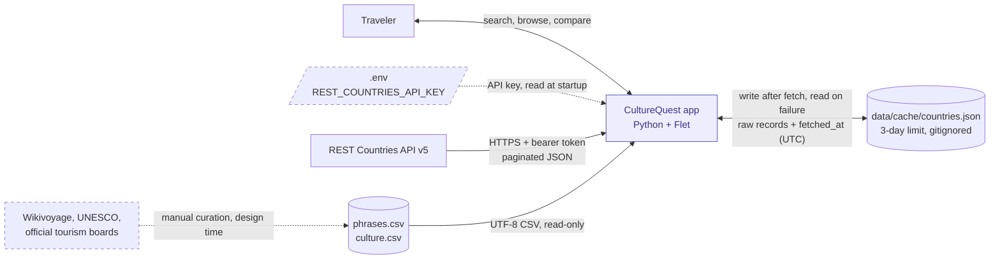
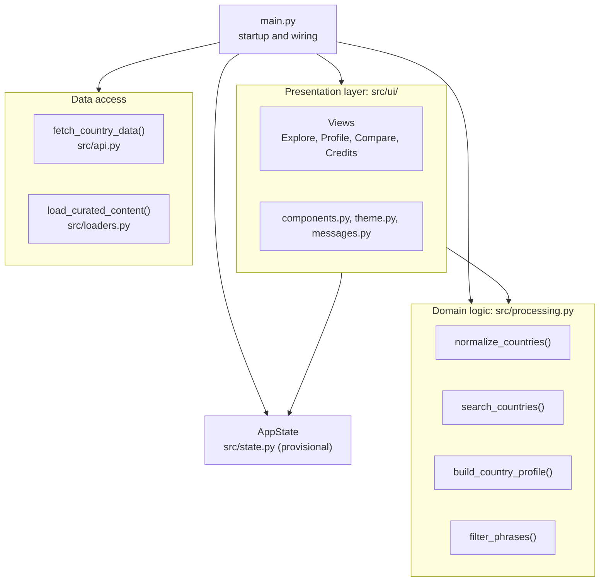
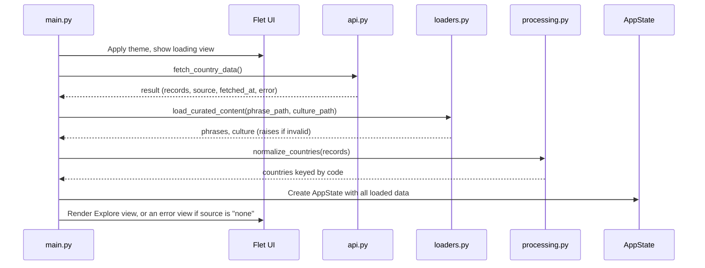

# CultureQuest — Architecture

*Living document. Started in Phase 1 (Architecture and design), October 2026.*

---

## 1. System context

This view shows CultureQuest as a single box and everything it depends on outside its boundary. Internal structure (layers, functions, screens) is covered in later sections.



Solid arrows are runtime data flows. Dashed arrows are configuration or manual, design-time inputs.

### Boundary notes

**Direction of data.** The REST Countries API and the curated CSVs are read-only from the app's side. The local cache is the only store the app both writes and reads: it writes after a successful API fetch and reads when the API is unavailable.

**Cache format.** One JSON file, `data/cache/countries.json`:

```json
{"fetched_at": "2026-10-27T19:42:00Z", "source": "restcountries-v5", "records": []}
```

- `fetched_at` is stored inside the file in UTC, rather than relying on the file's modified time, so the 3-day age check is explicit and testable.
- `records` holds **raw** API records. Live and cached data both pass through `normalize_countries()`, so there is a single transformation path.
- Per the REST Countries terms, cached data older than 3 days is not used, and the cache folder is never committed or submitted.

**Configuration.** The API key is read from `.env` at startup. A missing or invalid key is the most likely failure on another machine, so the app reports it with a clear message instead of crashing (see Section 4, Flows).

**Curated content.** Wikivoyage phrasebooks, UNESCO Intangible Cultural Heritage lists, and official tourism boards are researched manually and recorded in the CSVs with a source URL and review date. The app never contacts these sites at runtime. Their attribution, along with REST Countries attribution, appears on the in-app Credits screen.

**Data source alternative (pending ADR-0001).** If the `mledoze/countries` dataset plus the World Bank API is approved, only the REST Countries box changes: it splits into a committed JSON file and a keyless API, and the `.env` input and 3-day cache rule no longer apply. Nothing inside the app boundary changes, which confirms the data-access layer is isolated correctly.

**Future (US-10, stretch).** Saved items would add a separate, writable local store for user data. It is not shown here because it is out of MVP scope.

---

## 2. Components

This view opens the app box from Section 1 and shows the modules inside it.



Arrows here mean **"calls or imports."** This is a different convention from Section 1, where arrows show the direction data flows.

| `src/constants.py` | Shared | Closed lists: phrase categories, fetch sources, error codes | Nothing |

### Modules and responsibilities

| Module | Layer | Responsibility | May import |
|---|---|---|---|
| `main.py` | Composition | Loads data at startup, normalizes it, creates `AppState`, launches the Flet app | Everything |
| `src/api.py` | Data access | `fetch_country_data()`: API calls, pagination, cache read/write, expiry | Standard library, `requests`, `python-dotenv` |
| `src/loaders.py` | Data access | `load_curated_content()`: reads and validates both CSVs | Standard library |
| `src/processing.py` | Domain logic | `normalize_countries()`, `search_countries()`, `build_country_profile()`, `filter_phrases()` | Standard library only |
| `src/state.py` | Shared state | `AppState`: holds loaded data and current selections | Standard library only |
| `src/ui/` | Presentation | Views, reusable components, theme, and the error-code-to-message lookup | `flet`, `flet-charts`, `processing`, `state` |

### Dependency rules

1. **Dependencies point one way.** Presentation may call domain logic; domain logic never imports Flet or anything in `src/ui/`.
2. **The domain layer is pure.** `processing.py` performs no file or network access, which is what makes it straightforward to test with pytest.
3. **The UI never calls the data-access layer directly.** It never imports `requests` or `api.py`. Startup loading happens in `main.py`; actions such as Retry go through `AppState`, which `main.py` connects to the data layer.
4. **Raw API field names stay inside `normalize_countries()`.** Every other module works only with the contracts in Section 3.

### Startup in brief

`main.py` calls `fetch_country_data()` and `load_curated_content()`, passes the raw records through `normalize_countries()`, stores everything in `AppState`, and starts the UI. The full sequence, including failure paths, is in Section 4.

### Requirement mapping (TR-01, TR-02)

- TR-01 (at least 3 programmer-defined functions or classes): six functions plus `AppState`.
- TR-02 (data transformation): `normalize_countries()`, which converts nested API JSON into the country contract.

### Provisional items

- **`src/loaders.py`** is a change from the original folder plan. CSV loading is data access, so it belongs outside `processing.py` (domain) and outside `api.py` (network). 
- **`AppState`** fields and methods are defined in Step 5.
- **`messages.py`** holds the lookup from error codes (Section 3.2) to user-facing text.
## 3. Data contracts

Contracts define what each function returns in every situation, so callers never have to guess. All contracts use plain dictionaries. Keys are always present, even when a value is `None`.

### 3.1 Country dictionary

Produced by `normalize_countries()`. All countries are stored in one dictionary keyed by country code (`countries["JP"]`).

```python
{
    "code": "JP",              # ISO alpha-2, uppercase: the join key
    "code3": "JPN",            # ISO alpha-3
    "name": "Japan",
    "official_name": "Japan",
    "capitals": ["Tokyo"],     # always a list; may be empty
    "region": "Asia",
    "subregion": "Eastern Asia",
    "languages": [{"code": "jpn", "name": "Japanese"}],
    "currencies": [{"code": "JPY", "name": "Japanese yen", "symbol": "¥"}],
    "population": 125124989,   # int, or None if missing
    "flag": "🇯🇵",
}
```

- Source-specific field names stay inside `normalize_countries()`.
- Missing data is `None` in the data layer; the UI displays "Unavailable."

### 3.2 `fetch_country_data()` result

```python
{"records": [...], "source": "live",  "fetched_at": "2026-10-28T01:33:00Z", "error": None}
{"records": [...], "source": "cache", "fetched_at": "2026-10-26T18:00:00Z", "error": "network"}
{"records": [],    "source": "none",  "fetched_at": None,                   "error": "no_api_key"}
```

| Key | Type | Purpose |
|---|---|---|
| `records` | list of raw API dictionaries | The data; empty list when nothing is available |
| `source` | `"live"`, `"cache"`, or `"none"` | Where the data came from; the UI checks this first |
| `fetched_at` | UTC ISO timestamp string, or `None` | Drives the "Showing saved data from…" notice |
| `error` | error code, or `None` | Why the live fetch failed |

**Error codes (closed list):** `no_api_key`, `auth_failed` (401/403), `rate_limited` (429), `network`, `bad_response`.

**Behavior by situation**

| Situation | Result | UI shows |
|---|---|---|
| API works | `source: "live"` | Normal app |
| API fails, cache ≤ 3 days old | `source: "cache"` + error code | Normal app with a saved-data notice |
| API fails, cache > 3 days old | `source: "none"`; expired cache is deleted | Error state with Retry |
| API fails, no cache | `source: "none"` | Error state with Retry |
| No API key | Network skipped; cache used if fresh, otherwise `source: "none"` | Saved-data notice, or a setup error pointing to the README |
| Corrupted cache file | Treated as no cache; file is deleted | Same as no cache |

**Design decisions**

- **Return, don't raise, for expected failures.** Every situation above is a normal outcome for an API-dependent app, and the UI needs to display each one. Exceptions are reserved for programming errors.
- **Catch specific exceptions** (`requests.RequestException`, `json.JSONDecodeError`), never a bare `except:`, so real bugs aren't disguised as network errors.
- **Codes, not messages.** User-facing wording lives in the presentation layer, which maps each error code to text. This keeps dependencies flowing one way.
- **Records stay raw.** The caller passes them to `normalize_countries()`, so live and cached data share one transformation path.
- **Expired caches are deleted,** in line with the REST Countries prohibition on long-term storage.

### 3.3 `build_country_profile()` result

A pure function: it joins already-loaded data by country code and performs no file or network access.

```python
{
    "country": {...},   # the country dictionary from 3.1, unchanged
    "phrases": [...],   # rows from phrases.csv for this country
    "culture": [...],   # rows from culture.csv for this country
}
```

| Input | Output |
|---|---|
| Valid code, curated country | `country` plus non-empty `phrases` and `culture` lists |
| Valid code, no curated content | `country` plus two empty lists |
| Unknown code | Raises `ValueError("Unknown country code: XX")` |

**Design decisions**

- **The country is nested, not flattened,** so the country contract stays intact and UI components that accept a country dictionary work on `profile["country"]` directly.
- **Unknown codes raise.** The UI only obtains codes from the `countries` dictionary, so an unknown code indicates a bug, not a user error.
- **No curated content returns empty lists, never `None`.** This is the normal case for most countries; the UI shows an empty state.
- **Phrases are a flat list,** sorted by category order and then CSV row order. Category filtering is a separate pure function, `filter_phrases(phrases, category=None)`. Culture notes are also flat; the UI can group them by `note_type`.
- **Validate at load time, trust at join time.** `normalize_countries()` and `load_curated_content()` trim and uppercase country codes and reject invalid ones, so the join compares codes directly.
- Every phrase and culture row keeps its `source_url` and `review_date` for attribution in the UI.

### 3.4 Phrase categories

A closed, ordered list shared by all countries. The CSV stores the slug; the UI maps each slug to a display label.

| Order | Slug | Display label | Covers |
|---|---|---|---|
| 1 | `greetings` | Greetings | Hello, goodbye, introductions |
| 2 | `basics` | Basics | Please, thank you, sorry, language help |
| 3 | `dining` | Dining | Ordering, paying, dietary needs |
| 4 | `getting_around` | Getting around | Directions, transit, taxis |
| 5 | `shopping` | Shopping | Prices, payment |
| 6 | `emergencies` | Emergencies | Help, police, medical |

**Rules**

- `load_curated_content()` rejects any row whose category is not in this list.
- Every curated country has at least one phrase in each category, so no filter shows an empty result.
- `build_country_profile()` sorts phrases by this order, then by CSV row order.
- The ordered list lives in `src/constants.py`, importable by every layer. Display labels live in `src/ui/messages.py`.
- Numbers and time expressions are out of scope for v1.0.

## 4. Flows

### 4.1 Startup sequence



**Rules**

- **The UI starts first.** The loading view appears before any network call, so the window is never blank during the three API requests.
- **Curated content is loaded even when country data fails,** so the app can report every problem at once.

### 4.2 Inside `fetch_country_data()`

```mermaid
flowchart TD
    start["fetch_country_data()"] --> key{"API key in .env?"}
    key -->|"yes"| call["Request all pages: limit=100, with timeout"]
    key -->|"no: error no_api_key"| readcache["Read cache file"]
    call --> ok{"All pages succeeded?"}
    ok -->|"yes"| write["Write cache: raw records + fetched_at"]
    write --> live["Return source: live"]
    ok -->|"no: set error code"| readcache
    readcache --> valid{"File exists and is valid JSON?"}
    valid -->|"no"| delbad["Delete file if corrupted"]
    delbad --> nodata["Return source: none, with error code"]
    valid -->|"yes"| fresh{"fetched_at within 3 days?"}
    fresh -->|"yes"| cached["Return source: cache, with error code"]
    fresh -->|"no"| delold["Delete expired cache"]
    delold --> nodata
```

**Rules**

- **All pages or nothing.** If any page fails, the whole live fetch is treated as failed. A partial country list would silently hide countries from search.
- **Every request has a timeout** (about 10 seconds), so a hung connection can't freeze the loading screen indefinitely.
- **No automatic retries in v1.0.** Three requests sit well under the 20-per-10-seconds rate limit, and the user has a Retry button.
- **A failed cache write doesn't fail the fetch.** The live data is still returned.

### 4.3 Curated content failures

The CSVs are part of the project, not external input, so a missing file or invalid row is a development error.

- `load_curated_content()` **raises** `ValueError` naming the file, row number, and problem (for example, `phrases.csv row 14: unknown category "food"`).
- `main.py` catches it, prints the full message to the terminal, and runs in **partial mode**: country search and profiles work, while phrase and culture sections show "Curated content is unavailable."

This keeps the error loud during development while still giving users a working app.

### 4.4 Retry

The error view's Retry button calls a reload method on `AppState`, which reruns steps 2–8 of the startup sequence and re-renders the current view. The UI still never calls the data-access layer directly.

### 4.5 User interaction flows

| User action | Function called | Result |
|---|---|---|
| Types in search or changes region | `search_countries(countries, query, region)` | Results list re-renders |
| Opens a country | `build_country_profile(code, countries, phrases, culture)` | Profile view |
| Selects a phrase category | `filter_phrases(phrases, category)` | Phrase list re-renders |
| Selects 2–5 countries to compare | `build_population_series(...)`, `build_language_matrix(...)` | Bar chart and language matrix |

All functions in this table are pure and run against data already held in `AppState`, so interactions need no network access.

## 5. Screens and navigation

*To do: screen list, navigation, and view states.*

## 6. Testing strategy

*To do.*
