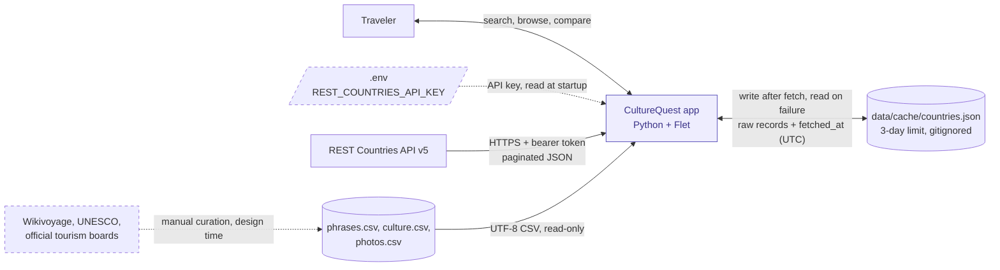
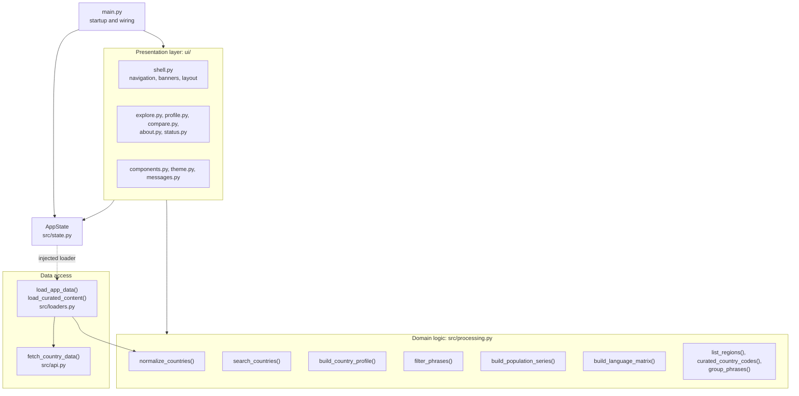
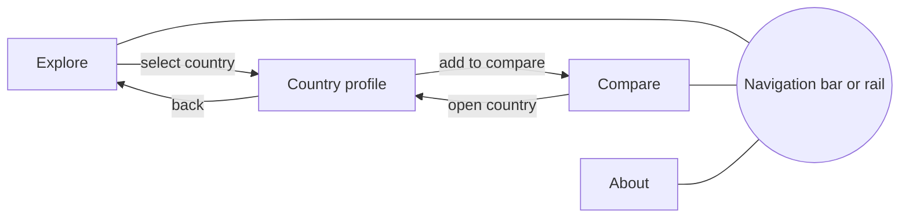

# CultureQuest — Architecture

*Phase 1 completed October 2026; updated October 29, 2026 for Phase 5 (presentation layer). Living document; update as the design changes.*

---

## 1. System context

This view shows CultureQuest as a single box and everything it depends on outside its boundary. Internal structure (layers, functions, screens) is covered in later sections.



Solid arrows are runtime data flows. Dashed arrows are configuration or manual, design-time inputs.

### Boundary notes

**Direction of data.** The REST Countries API and the curated CSVs are read-only from the app's side. The local cache is the only store the app both writes and reads: it writes after a successful API fetch and reads when the API is unavailable.

**Cache format.** One JSON file, `data/cache/countries.json`:

```json
{"fetched_at": "2026-10-27T19:42:00Z", "provider": "restcountries-v5", "records": []}
```

- `fetched_at` is stored inside the file in UTC, rather than relying on the file's modified time, so the 3-day age check is explicit and testable.
- `provider` names the data provider. It is deliberately not called `source`, which in Section 3.2 means where a result came from (`live`, `cache`, or `none`).
- `records` holds **raw** API records. Live and cached data both pass through `normalize_countries()`, so there is a single transformation path.
- Per the REST Countries terms, cached data older than 3 days is not used, and the cache folder is never committed or submitted.

**Configuration.** The API key is read from `.env` at startup. A missing or invalid key is the most likely failure on another machine, so the app reports it with a clear message instead of crashing (see Section 4, Flows).

**Curated content.** Wikivoyage phrasebooks, UNESCO Intangible Cultural Heritage lists, and official tourism boards are researched manually and recorded in the CSVs with a source URL and review date. The app never contacts these sites at runtime. Their attribution, along with REST Countries attribution, appears on the in-app About screen.

**Data source alternative (pending ADR-0001).** If the `mledoze/countries` dataset plus the World Bank API is approved, only the REST Countries box changes: it splits into a committed JSON file and a keyless API, and the `.env` input and 3-day cache rule no longer apply. Nothing inside the app boundary changes, which confirms the data-access layer is isolated correctly.

**Future (US-10, stretch).** Saved items would add a separate, writable local store for user data. It is not shown here because it is out of MVP scope.

---

## 2. Components

This view opens the app box from Section 1 and shows the modules inside it.



Arrows here mean **"calls or imports."** This is a different convention from Section 1, where arrows show the direction data flows. `src/constants.py` is omitted from the diagram because every module may import it.

### Modules and responsibilities

| Module | Layer | Responsibility | May import |
|---|---|---|---|
| `main.py` | Composition | Loads `.env`, applies the theme, creates `AppState(loader=load_app_data)` and `AppShell`, launches the Flet app | Everything |
| `src/constants.py` | Shared | Closed lists and fixed values: phrase categories, fetch sources, error codes, file paths | Nothing |
| `src/api.py` | Data access | `fetch_country_data()`: API calls, pagination, cache read/write, expiry | Standard library, `requests`, `python-dotenv`, `constants` |
| `src/loaders.py` | Data access | `load_curated_content()`: reads and validates the three CSVs. `load_app_data()`: the loader `AppState` calls (fetch → normalize → CSVs; a CSV error becomes `content_error`) | Standard library, `constants`, `api`, `processing` |
| `src/processing.py` | Domain logic | `normalize_countries()`, `search_countries()`, `build_country_profile()`, `filter_phrases()`, `build_population_series()`, `build_language_matrix()`, plus the screen lookups `list_regions()`, `curated_country_codes()`, `group_phrases()` | Standard library, `constants` |
| `src/state.py` | Shared state | `AppState`: holds loaded data and current selections | Standard library, `constants` |
| `ui/` | Presentation | `shell.py` (startup flow, navigation, banners, phone/desktop layout), one file per screen, `components.py` (one builder per component), `theme.py` (every design value), `messages.py` (all user-facing text, pure and unit-tested) | `flet`, `flet-charts`, `processing`, `state`, `constants` |

### Dependency rules

1. **Dependencies point one way.** Presentation may call domain logic; domain logic never imports Flet or anything in `ui/`. The UI lives in a top-level `ui/` package so `src/` stays UI-free (ADR-0004).
2. **The domain layer is pure.** `processing.py` performs no file or network access, which is what makes it straightforward to test with pytest.
3. **The UI never calls the data-access layer directly.** It never imports `requests`, `api.py` or `loaders.py`. Startup and Retry both call `AppState.reload()`, which runs the loader `main.py` injected (`load_app_data()`).
4. **Raw API field names stay inside `normalize_countries()`.** Every other module works only with the contracts in Section 3.

### AppState

A dataclass in `src/state.py`. It holds loaded data and the selections that must persist across views, and it enforces the rules that protect them. One instance is created in `main.py` and passed to each view; there are no globals.

**Loaded data:** `countries`, `phrases`, `culture`, `photos`, `source`, `fetched_at`, `fetch_error`, `content_error` (set when CSV validation fails and the app runs in partial mode).

**Persistent selections:** `search_query`, `region_filter`, `compare_codes`. Selections used by only one view, such as the phrase category and the profile tab, stay local to that view (`ProfileScreen`).

| Method | Returns | Rule |
|---|---|---|
| `reload()` | `None` | Reruns the loading pipeline and replaces all loaded data at once |
| `add_to_compare(code)` | `bool` | Max 5, no duplicates; `False` when the limit is reached |
| `remove_from_compare(code)` | `None` | No-op if the code is not selected |
| `can_compare()` | `bool` | True when 2–5 countries are selected |

**Dependency injection.** `main.py` passes its loading-pipeline function to `AppState` at creation. `reload()` calls it without knowing its contents, so `state.py` stays independent of the network and files, and tests can supply a fake loader.

**Refreshing views.** The view that calls a state method re-renders its own controls; it tells the shell through a callback when something outside it changes (Add to compare → the Compare count badge).

### Startup in brief

`main.py` creates `AppState(loader=load_app_data)` and `AppShell`, and calls `shell.load()`: the Loading view appears, `AppState.reload()` runs the loader, and the shell shows Explore or the Error view. The full sequence, including failure paths, is in Section 4.

### Requirement mapping (TR-01, TR-02)

- TR-01 (at least 3 programmer-defined functions or classes): the data and domain functions above, the `AppState`, `AppShell`, `ExploreScreen` and `ProfileScreen` classes, and the formatting functions in `ui/messages.py`.
- TR-02 (data transformation): `normalize_countries()`, which converts nested API JSON into the country contract. `build_population_series()` and `build_language_matrix()` also reshape data for the visualizations.

### Changes from the original plan

- **`src/loaders.py`** was added. CSV loading is data access, so it belongs outside `processing.py` (domain) and outside `api.py` (network).
- **`src/constants.py`** and **`src/state.py`** were added to hold shared closed lists and app state.
- **Phase 5:** the UI moved from `src/ui/` to a top-level `ui/` package (ADR-0004), and `load_app_data()` became the single loader used at startup and on Retry, instead of `main.py` calling each data function.

---

## 3. Data contracts

Contracts define what each function returns in every situation, so callers never have to guess. All contracts use plain dictionaries. Keys are always present, even when a value is `None`.

### 3.1 Country dictionary

Produced by `normalize_countries()`. All countries are stored in one dictionary keyed by country code (`countries["JP"]`).

```python
{
    "code": "JP",              # ISO alpha-2, uppercase: the join key
    "code3": "JPN",            # ISO alpha-3
    "name": "Japan",
    "official_name": "Japan",
    "capitals": ["Tokyo"],     # always a list; may be empty
    "region": "Asia",
    "subregion": "Eastern Asia",
    "languages": [{"code": "jpn", "name": "Japanese"}],
    "currencies": [{"code": "JPY", "name": "Japanese yen", "symbol": "¥"}],
    "population": 125124989,   # int, or None if missing
    "flag": "https://flagcdn.com/w320/jp.png",  # PNG URL, or None
}
```

- Source-specific field names stay inside `normalize_countries()`.
- Missing data is `None` in the data layer; the UI displays "Unavailable."

### 3.2 `fetch_country_data()` result

```python
{"records": [...], "source": "live",  "fetched_at": "2026-10-28T01:33:00Z", "error": None}
{"records": [...], "source": "cache", "fetched_at": "2026-10-26T18:00:00Z", "error": "network"}
{"records": [],    "source": "none",  "fetched_at": None,                   "error": "no_api_key"}
```

| Key | Type | Purpose |
|---|---|---|
| `records` | list of raw API dictionaries | The data; empty list when nothing is available |
| `source` | `"live"`, `"cache"`, or `"none"` | Where the data came from; the UI checks this first |
| `fetched_at` | UTC ISO timestamp string, or `None` | Drives the "Showing saved data from…" notice |
| `error` | error code, or `None` | Why the live fetch failed |

**Error codes (closed list):** `no_api_key`, `auth_failed` (401/403), `rate_limited` (429), `network`, `bad_response`.

**Behavior by situation**

| Situation | Result | UI shows |
|---|---|---|
| API works | `source: "live"` | Normal app |
| API fails, cache ≤ 3 days old | `source: "cache"` + error code | Normal app with a saved-data notice |
| API fails, cache > 3 days old | `source: "none"`; expired cache is deleted | Error state with Retry |
| API fails, no cache | `source: "none"` | Error state with Retry |
| No API key | Network skipped; cache used if fresh, otherwise `source: "none"` | Saved-data notice, or a setup error pointing to the README |
| Corrupted cache file | Treated as no cache; file is deleted | Same as no cache |

**Design decisions**

- **Return, don't raise, for expected failures.** Every situation above is a normal outcome for an API-dependent app, and the UI needs to display each one. Exceptions are reserved for programming errors.
- **Catch specific exceptions** (`requests.RequestException`, `json.JSONDecodeError`), never a bare `except:`, so real bugs aren't disguised as network errors.
- **Codes, not messages.** User-facing wording lives in the presentation layer, which maps each error code to text. This keeps dependencies flowing one way.
- **Records stay raw.** The caller passes them to `normalize_countries()`, so live and cached data share one transformation path.
- **Expired caches are deleted,** in line with the REST Countries prohibition on long-term storage.
- **Replaceable cache path.** `fetch_country_data(cache_path=DEFAULT_CACHE_PATH)` lets tests use a temporary folder; normal calls pass no arguments.

### 3.3 `build_country_profile()` result

A pure function: it joins already-loaded data by country code and performs no file or network access.

```python
{
    "country": {...},   # the country dictionary from 3.1, unchanged
    "phrases": [...],   # rows from phrases.csv for this country
    "culture": [...],   # rows from culture.csv for this country
    "photo": {...},     # the photos.csv row for this country, or None
}
```

| Input | Output |
|---|---|
| Valid code, curated country | `country` plus non-empty `phrases` and `culture` lists |
| Valid code, no curated content | `country` plus two empty lists and `photo: None` |
| Unknown code | Raises `ValueError("Unknown country code: XX")` |

**Design decisions**

- **The country is nested, not flattened,** so the country contract stays intact and UI components that accept a country dictionary work on `profile["country"]` directly.
- **Unknown codes raise.** The UI only obtains codes from the `countries` dictionary, so an unknown code indicates a bug, not a user error.
- **No curated content returns empty lists, never `None`.** This is the normal case for most countries; the UI shows an empty state.
- **Phrases are a flat list,** sorted by category order and then CSV row order. Category filtering is a separate pure function, `filter_phrases(phrases, category=None)`. Culture notes are also flat; the UI can group them by `note_type`.
- **Validate at load time, trust at join time.** `normalize_countries()` and `load_curated_content()` trim and uppercase country codes and reject invalid ones, so the join compares codes directly.
- Every phrase and culture row keeps its `source_url` and `review_date` for attribution in the UI.

### 3.4 Phrase categories

A closed, ordered list shared by all countries. The CSV stores the slug; the UI maps each slug to a display label.

| Order | Slug | Display label | Covers |
|---|---|---|---|
| 1 | `greetings` | Greetings | Hello, goodbye, introductions |
| 2 | `basics` | Basics | Please, thank you, sorry, language help |
| 3 | `dining` | Dining | Ordering, paying, dietary needs |
| 4 | `getting_around` | Getting around | Directions, transit, taxis |
| 5 | `shopping` | Shopping | Prices, payment |
| 6 | `emergencies` | Emergencies | Help, police, medical |

**Rules**

- `load_curated_content()` rejects any row whose category is not in this list.
- Every curated country has at least one phrase in each category, so no filter shows an empty result.
- `build_country_profile()` sorts phrases by this order, then by CSV row order.
- The ordered list lives in `src/constants.py`, importable by every layer. Display labels live in `ui/messages.py` (`category_label()`).
- Numbers and time expressions are out of scope for v1.0.

---

## 4. Flows

### 4.1 Startup sequence

```mermaid
sequenceDiagram
    participant M as main.py
    participant SH as AppShell (ui/shell.py)
    participant S as AppState
    participant L as load_app_data()
    participant A as api.py
    participant P as processing.py

    M->>M: load_dotenv(), apply_theme(page)
    M->>SH: AppShell(page, AppState(loader=load_app_data))
    M->>SH: shell.load()
    SH->>SH: Show Loading view
    SH->>S: reload()
    S->>L: loader()
    L->>A: fetch_country_data()
    A-->>L: records, source, fetched_at, error
    L->>P: normalize_countries(records)
    L->>L: load_curated_content() (ValueError → content_error)
    L-->>S: countries, phrases, culture, photos, source, fetched_at, fetch_error, content_error
    SH->>SH: No countries → Error view with Retry; otherwise Explore (+ banners)
```

**Rules**

- **The UI starts first.** The Loading view appears before any network call, so the window is never blank during the three API requests.
- **Curated content is loaded even when country data fails,** so the app can report every problem at once.
- **Banners:** `source == "cache"` adds the offline banner ("Showing saved data from {date}." with Retry and Dismiss, US-08); `content_error` adds the partial-mode banner. Both sit at the top of the content area, beside the rail on desktop, never over it.

### 4.2 Inside `fetch_country_data()`

```mermaid
flowchart TD
    start["fetch_country_data()"] --> key{"API key in .env?"}
    key -->|"yes"| call["Request all pages: limit=100, with timeout"]
    key -->|"no: error no_api_key"| readcache["Read cache file"]
    call --> ok{"All pages succeeded?"}
    ok -->|"yes"| write["Write cache: raw records + fetched_at"]
    write --> live["Return source: live"]
    ok -->|"no: set error code"| readcache
    readcache --> valid{"File exists and is valid JSON?"}
    valid -->|"no"| delbad["Delete file if corrupted"]
    delbad --> nodata["Return source: none, with error code"]
    valid -->|"yes"| fresh{"fetched_at within 3 days?"}
    fresh -->|"yes"| cached["Return source: cache, with error code"]
    fresh -->|"no"| delold["Delete expired cache"]
    delold --> nodata
```

**Rules**

- **All pages or nothing.** If any page fails, the whole live fetch is treated as failed. A partial country list would silently hide countries from search.
- **Every request has a timeout** (about 10 seconds), so a hung connection can't freeze the loading screen indefinitely.
- **No automatic retries in v1.0.** Three requests sit well under the 20-per-10-seconds rate limit, and the user has a Retry button.
- **A failed cache write doesn't fail the fetch.** The live data is still returned.

### 4.3 Curated content failures

The CSVs are part of the project, not external input, so a missing file or invalid row is a development error.

- `load_curated_content()` **raises** `ValueError` naming the file, row number, and problem (for example, `phrases.csv row 14: unknown category "food"`).
- `load_app_data()` catches it and stores the message in `content_error`, and the app runs in **partial mode**: country search and profiles work, and a banner says "Phrases and cultural notes couldn't load. Country facts are still available." The full message stays in `AppState.content_error` for debugging.

This keeps the error loud during development while still giving users a working app.

### 4.4 Retry

The Error view's Retry button and the offline banner's Retry both call `AppShell.load()`: it shows the Loading view, calls `AppState.reload()` (which reruns the loader from Section 4.1), resets dismissed banners and returns to Explore. The UI still never calls the data-access layer directly.

### 4.5 User interaction flows

| User action | Function called | Result |
|---|---|---|
| Types in search or changes region | `search_countries(countries, query, region)` | Results list re-renders (tiles are built once and reused) |
| Opens a country | `build_country_profile(code, countries, phrases, culture, photos)` | Profile view |
| Selects a phrase category | `group_phrases(phrases)`, filtered to the category | Phrase list re-renders (group headings only under All) |
| Selects 2–5 countries to compare | `build_population_series(...)`, `build_language_matrix(...)` | Bar chart and language matrix |

All functions in this table are pure and run against data already held in `AppState`, so interactions need no network access.

---

## 5. Screens and navigation

### 5.1 Screens and routes

| Screen | File | Purpose | Key stories |
|---|---|---|---|
| Explore | `ui/explore.py` | Search and region filter; alphabetical results | US-01, US-02 |
| Country profile | `ui/profile.py` | Facts, phrases, cultural notes, add to compare | US-03 to US-05, US-09 (tentative) |
| Compare | `ui/compare.py` | Tray, Add country picker (dialog using `search_countries()`), population chart and language matrix (placeholders until Phase 6) | US-06, US-07 |
| About | `ui/about.py` | App description, data status (source and fetch date), sources and licenses | TR-05, REST Countries terms |
| Loading, Error, banners | `ui/status.py` | App-wide states | US-08 |



### 5.2 Navigation

- **Top-level destinations:** Explore, Compare, About. The profile is a detail screen with a back arrow, not a destination.
- **Below 768px:** bottom `NavigationBar`. **768px and above:** side `NavigationRail`. `page.on_resize` re-lays out the frame only when the width crosses 768px.
- **State-based navigation (changed in Phase 5).** `AppShell` keeps the selected destination and the open profile, and rebuilds the frame when they change. The profile's back arrow closes it and returns to the destination underneath. Flet routes were dropped: a desktop app has no URL bar, and one shell object is simpler to follow and test by hand. The Compare destination shows a count badge when countries are selected.
- **Test widths:** 380px, 767px, 768px, 1280px.

### 5.3 Layout decisions

The hi-fi design pass ("Passport teal", Phase 4.5) set the layouts below; where it differs from earlier plans, the hi-fi wins.

- **Explore:** title block, pill search field, a row with the result count and a compact Region dropdown, then a full-bleed country list. Curated countries carry a "Phrases" badge. Desktop centers the same layout in a 720px column beside the rail.
- **Profile, phone:** back arrow, full-bleed photo with credit, flag + name + region, Add to compare, Key facts card, then **tabs** (Phrases · Cultural notes). Phrases have category chips, group headings under "All", and one source line.
- **Profile, desktop:** content up to 1104px wide: photo banner, header row with Add to compare on the right, then two columns (2fr/3fr): Key facts and Cultural notes on the left, Phrases in a two-column card grid on the right. No tabs.
- **Uncurated countries:** no photo or tabs; a notice card lists the curated countries.
- **Compare selection:** a search picker on the Compare screen (reusing `search_countries()`) and an "Add to compare" button on each profile with three states (Add, In compare, Compare is full). Both use `AppState` methods, so the 2–5 rule is enforced in one place.
- **US-09 (tentative):** a compact quick-reference section on the profile showing Emergencies and Basics phrases in large text. To be confirmed against US-09 acceptance criteria.
- **Attribution:** full credits on About, plus "Country data: REST Countries" at the bottom of the profile and a credit line under each photo.

### 5.4 View states

All data is loaded once at startup and held in `AppState`, so individual screens never load. Loading is a single app-level state shown at startup and during Retry.

| Screen | Empty | Error | Partial / missing |
|---|---|---|---|
| App-wide | — | `source: "none"`: full-screen error (message from error code) with Retry | `source: "cache"`: "Showing saved data from {date}" banner on every screen |
| Explore | No matches: "No countries match “{query}”." plus Clear search. A blank search lists all countries. | — | — |
| Profile | No curated content: "Phrases and notes aren't available yet" card | — | Missing fields and failed images: "Unavailable," flag placeholder with the country code, landscape placeholder for the photo. Partial mode: app-wide banner |
| Compare | Fewer than 2 selected: "Add 2 to 5 countries…" / "Add one more country…"; at 5 the Add country button is disabled | — (a sixth country can't be added) | Missing population: bar omitted, labeled "Population unavailable." No languages: "No language data." |
| About | — | — | — |

The phrase category filter has no empty state; Section 3.4 guarantees every curated country has at least one phrase per category.

### 5.5 Design references

- Hi-fi canvas ("CultureQuest Hi-fi"): the visual target for Phase 5. Its values are transferred to code in `ui/theme.py` (ADR-0005).
- Lo-fi wireframes (all 10 artboards) and the design system document: the layout record for screens the hi-fi did not redraw (About, Compare desktop).

### 5.6 Presentation-layer rules

- **`ui/theme.py` is the only place design values live.** Screens use `ft.Colors` role names (`PRIMARY`, `SURFACE_CONTAINER_HIGH`, …) and theme constants, never hex codes; changing `SEED` recolors the app (ADR-0005).
- **`ui/messages.py` holds every user-facing string** and formatting function (population, dates, error reasons, labels). It is pure and unit-tested.
- **One builder per component** in `ui/components.py` (card, search field, country tile, flag, phrase card, buttons, banner, …). Builders take plain data and callbacks and never read `AppState`.
- **Screens are small classes** (`ExploreScreen`, `ProfileScreen`) that keep their own controls, so search text, chips and tabs survive navigation and resizing. Parts that change after a click are replaced inside a slot container, so the scroll position stays.

---

## 6. Testing strategy

### 6.1 Scope

| Part | Method | Notes |
|---|---|---|
| `src/processing.py` | pytest | Pure functions; highest value per test |
| `src/state.py` | pytest with a fake loader | Uses the injected loader (Section 2) |
| `src/loaders.py` | pytest with fixture CSVs | Valid file plus one file per validation rule |
| `src/api.py` | pytest with faked network and `tmp_path` cache | Covers every branch in Section 4.2 |
| `ui/messages.py` | pytest | Exact wording and formatting |
| `ui/` screens | Screenshots at 390 and 1280px in Flet web mode, then the manual checklist (6.5) | Not unit-tested |

**Definition of "enough":** every row in every contract table (Sections 3.2, 3.3, 3.4, and the AppState method table) has at least one test.

### 6.2 Network and file isolation

- Tests never call the live API. `monkeypatch` replaces `requests.get` with fakes that return pages, error statuses, or timeouts.
- Tests never touch `data/cache/`. `fetch_country_data(cache_path=...)` accepts an optional path; tests pass a file inside `tmp_path`.
- Cache age is tested by writing `fetched_at` values relative to the current time (for example, 1 day and 5 days old).

### 6.3 Fixtures

- **Raw API records:** hand-written records for Japan, South Africa (multiple capitals), Switzerland (multiple languages), and Antarctica (missing fields), structured like v5 responses. No real API responses are committed, in line with the REST Countries terms.
- **Normalized countries:** shared fixtures in `tests/conftest.py`.
- **CSVs:** `tests/fixtures/` holds one valid phrases file, one valid culture file, and one invalid file per validation rule.

### 6.4 Key cases

| Function | Cases |
|---|---|
| `normalize_countries()` | Single capital; multiple capitals; multiple languages; missing fields become `None` or empty lists; codes uppercased |
| `search_countries()` | Partial match; case-insensitive; region filter; blank query returns all; alphabetical order; no matches returns empty list |
| `build_country_profile()` | Curated country; uncurated country returns empty lists; unknown code raises `ValueError`; phrases sorted by category order |
| `filter_phrases()` | Each category; `None` returns all |
| `build_population_series()` | 2 and 5 countries; missing population handled |
| `build_language_matrix()` | Shared languages; no shared languages; country with no languages |
| `load_curated_content()` | Valid files; unknown category; invalid country code; missing column; error message names file and row |
| `fetch_country_data()` | Every path in Section 4.2: live success, each error code, fresh cache, expired cache deleted, corrupted cache deleted, no cache, no API key |
| `AppState` | Compare limit of 5; duplicates rejected; `can_compare()` at 1, 2, and 5; `reload()` replaces all data |

### 6.5 Manual UI checklist

Used in Phase 8. For each screen, at 380px, 767px, 768px, and 1280px:

- Every state in Section 5.4 can be triggered and displays correctly.
- Navigation switches between bar and rail at 768px.
- Back navigation returns from a profile to its origin screen.
- Attribution appears on About and in the profile's facts section.

### 6.6 Workflow

- Tests are written alongside each function.
- `ruff check .` and `pytest` run before every commit.
- Optional: a GitHub Actions workflow runs both on every push.

---

## 7. Conventions

### 7.1 Code style

- **Naming:** `snake_case` for modules, functions, variables, dictionary keys, and CSV columns; `PascalCase` for classes; `UPPER_SNAKE_CASE` for constants. Category slugs and error codes are lowercase.
- **Type hints** on every public function's parameters and return value.
- **Docstrings** on every public function: one-line purpose, then Args, Returns, and Raises where relevant.
- **Imports:** absolute (`from src.processing import search_countries`), grouped as standard library, third-party, then local. Ruff sorts them.
- **Formatting and linting:** Ruff, configured in `pyproject.toml`.

```toml
[tool.ruff]
line-length = 100

[tool.ruff.lint]
select = ["E", "F", "I", "B", "UP"]
```

### 7.2 Design rules

- **Return, don't raise, for expected failures;** raise only for programming errors (Section 3.2).
- **Catch specific exceptions;** never use a bare `except:`.
- **Clean data once, at the boundary** where it enters the program (Section 3.3).
- **No hardcoded data.** File paths and closed lists live in `src/constants.py`; secrets live only in `.env`.
- **User-facing text lives only in `ui/messages.py`.**
- **Timestamps** are UTC, ISO 8601, ending in `Z`.
- **Dependencies point one way** (Section 2).

### 7.3 Git workflow

- **One branch per issue,** named after it: `us-01-destination-search`.
- **Commit messages** use a type prefix: `feat:`, `fix:`, `test:`, `docs:`, `refactor:`, `chore:`.
- **Before every commit:** `ruff check .`, `pytest`, and `git status` (no `.env`, `.venv`, or `data/cache/`).
- **Pull requests** include `Closes #N` and confirm which acceptance criteria were verified.
- **`main` always runs.** Unfinished work stays on its branch.
- **Versions are pinned** in `requirements.txt`, especially Flet.

### 7.4 Definition of Done

A backlog item is done when its acceptance criteria are verified, its tests pass, Ruff reports no issues, relevant states in Section 5.4 are handled, and it is merged to `main`. The full checklist is Appendix B of the User Stories document.

### 7.5 Decisions

Architecture decisions are recorded in `docs/adr/`:

| ADR | Decision | Status |
|---|---|---|
| [0001](adr/0001-data-source-and-caching.md) | Country data source and caching | Proposed |
| [0002](adr/0002-flet-for-ui.md) | Flet as the UI framework | Accepted |
| [0003](adr/0003-in-memory-data-no-database.md) | In-memory dictionaries, no database | Accepted |
| [0004](adr/0004-ui-package-structure.md) | Top-level `ui/` package: shell, one file per screen, pure messages | Accepted |
| [0005](adr/0005-hifi-theme-seed-and-bundled-fonts.md) | Seed-based Material 3 theme and bundled Noto fonts | Accepted |