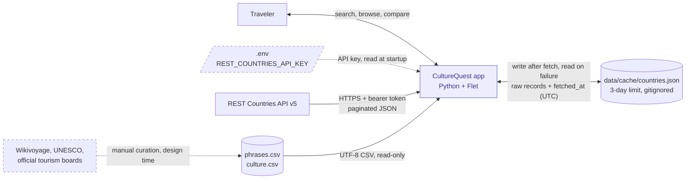

# CultureQuest — Architecture

*Living document. Started in Phase 1 (Architecture and design), October 2026.*

---

## 1. System context

This view shows CultureQuest as a single box and everything it depends on outside its boundary. Internal structure (layers, functions, screens) is covered in later sections.



Solid arrows are runtime data flows. Dashed arrows are configuration or manual, design-time inputs.

### Boundary notes

**Direction of data.** The REST Countries API and the curated CSVs are read-only from the app's side. The local cache is the only store the app both writes and reads: it writes after a successful API fetch and reads when the API is unavailable.

**Cache format.** One JSON file, `data/cache/countries.json`:

```json
{"fetched_at": "2026-10-27T19:42:00Z", "source": "restcountries-v5", "records": []}
```

- `fetched_at` is stored inside the file in UTC, rather than relying on the file's modified time, so the 3-day age check is explicit and testable.
- `records` holds **raw** API records. Live and cached data both pass through `normalize_countries()`, so there is a single transformation path.
- Per the REST Countries terms, cached data older than 3 days is not used, and the cache folder is never committed or submitted.

**Configuration.** The API key is read from `.env` at startup. A missing or invalid key is the most likely failure on another machine, so the app reports it with a clear message instead of crashing (see Section 4, Flows).

**Curated content.** Wikivoyage phrasebooks, UNESCO Intangible Cultural Heritage lists, and official tourism boards are researched manually and recorded in the CSVs with a source URL and review date. The app never contacts these sites at runtime. Their attribution, along with REST Countries attribution, appears on the in-app Credits screen.

**Data source alternative (pending ADR-0001).** If the `mledoze/countries` dataset plus the World Bank API is approved, only the REST Countries box changes: it splits into a committed JSON file and a keyless API, and the `.env` input and 3-day cache rule no longer apply. Nothing inside the app boundary changes, which confirms the data-access layer is isolated correctly.

**Future (US-10, stretch).** Saved items would add a separate, writable local store for user data. It is not shown here because it is out of MVP scope.

---

## 2. Components

*To do: the three layers, the five functions, and `AppState`.*

## 3. Data contracts

*To do: country dictionary, `fetch_country_data()` result, `build_country_profile()` result, phrase categories.*

## 4. Flows

*To do: startup sequence and failure handling.*

## 5. Screens and navigation

*To do: screen list, navigation, and view states.*

## 6. Testing strategy

*To do.*
